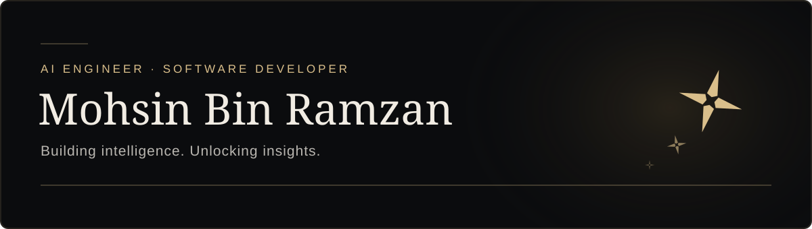

# Mohsin Bin Ramzan

**Intelligent applications &nbsp; · &nbsp; Meaningful insights &nbsp; · &nbsp; Smarter workflows**

  
  
  

  
  
  

[🧑‍💻 About](#-the-developer-behind-the-data) &nbsp; / &nbsp; [🛠️ Stack](#-my-technical-universe) &nbsp; / &nbsp; [🚀 Projects](#-selected-projects) &nbsp; / &nbsp; [🤝 Connect](#-lets-build-something-impactful)

## 🧑‍💻 The developer behind the data

I'm **Mohsin Bin Ramzan**, an **AI Engineer** focused on **Generative AI and Data Analytics**. I enjoy turning complex data and ambitious ideas into practical, intelligent solutions.

- 🤖 **I build** AI applications and automated workflows.
- 📊 **I explore** data to uncover useful patterns and insights.
- 🧠 **I'm deepening my skills in** NLP, deep learning, and computer vision.
- 🐍 **My go-to tools** include Python, SQL, and machine learning frameworks.
- 🌍 **Based in** Rawalpindi, Pakistan.
- 🤝 **Open to** freelance projects and collaboration.

> 💡 **What drives me:** Making AI useful, data understandable, and everyday work easier.

 

## ✨ Where I turn ideas into solutions

| 🧠 Generative AI & NLP | 👁️ Machine Learning & Vision |
| :--- | :--- |
| Language model applications, conversational systems, and AI-assisted content workflows. | Predictive modeling, image analysis, detection, and recognition tasks. |
| **📊 Analytics & Visualization** | **⚙️ Workflow Automation** |
| Exploring data and communicating findings through clear, useful dashboards. | Connecting data and tools with Python to streamline repetitive processes. |

## 🛠️ My technical universe

### ⌨️ Languages

### 🤖 Machine Learning & Artificial Intelligence

### 📈 Data Analysis & Visualization

### 🗄️ Databases

### 🔧 Development & Productivity

## 🚀 Selected projects

**From language models to visual intelligence — explore the work.**

<table>
<tr>
<td width="50%" valign="top">
<h3>📚 Automated Book Generation</h3>

AI-assisted outlines and chapters with editorial feedback, multiple LLM providers, and document export.

  

<a href="https://github.com/MOHSINBINRAMZAN/Automated-Book-Generation-System-using-AI"><b>Explore project</b></a>
</td>
<td width="50%" valign="top">
<h3>🧠 LLM Fine-Tuning</h3>

A repository exploring language model fine-tuning and natural language processing.

 

<a href="https://github.com/MOHSINBINRAMZAN/LLM-Fine-Tuning"><b>Explore project</b></a>
</td>
</tr>
<tr>
<td width="50%" valign="top">
<h3>🚘 Automatic Number Plate Recognition</h3>

Vehicle and license plate detection with YOLOv8, paired with EasyOCR for text recognition.

  

<a href="https://github.com/MOHSINBINRAMZAN/ANPR-automatic-number-plate-recognition-"><b>Explore project</b></a>
</td>
<td width="50%" valign="top">
<h3>🏏 Cricket Score Analytics</h3>

A dashboard project focused on exploring and visualizing Virat Kohli's scoring data.

 

<a href="https://github.com/MOHSINBINRAMZAN/Virat-Kohli-Score-Analysis-Dashboard"><b>Explore project</b></a>
</td>
</tr>
</table>

## 📊 My GitHub in motion

<b>🔎 Explore language activity</b>

 

Language statistics reflect repository code, rather than proficiency.

## 🤝 Let's build something impactful

**Have an AI idea, a dataset to explore, or a workflow to automate?**  
Let's turn it into something useful.

  
  
  

**💼 Open to freelance projects &nbsp; • &nbsp; 🌍 Open to collaboration**

<a href="mailto:mohsinramzan248@gmail.com">mohsinramzan248@gmail.com</a>

  

